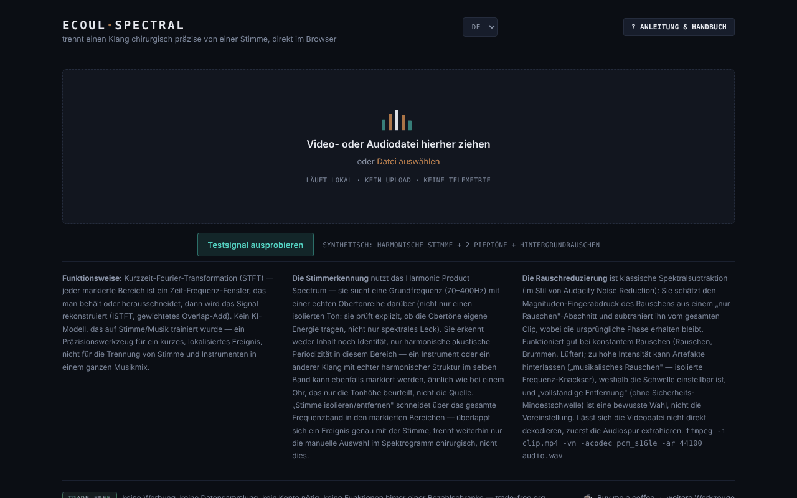

# Ecoul Spectral

[English](README.md) · [Română](README.ro.md) · [Français](README.fr.md) · [Italiano](README.it.md) · [Español](README.es.md) · [Português](README.pt.md) · **Deutsch** · [Magyar](README.hu.md)

**Version:** 1.2.1 · **Zuletzt aktualisiert:** 2026-10-22

Oberflächensprachen: **Română, English, Français, Italiano, Español, Português (PT), Deutsch, Magyar**

Trenne einen Klang von einer Stimme, chirurgisch genau, direkt im Browser — ein Spektraleditor in einer einzigen HTML-Datei.

**Online-App:** https://chiuta.github.io/EcoulSpectral/

## Was es ist

Ecoul Spectral ist ein Spektrogramm-Editor, der lokal im Browser läuft. Du lädst eine Audio- oder Videodatei, markierst im Spektrogramm einen Zeit-Frequenz-Bereich und isolierst oder entfernst ihn dann. Enthalten sind automatische Stimmerkennung, Rauschunterdrückung und WAV-Export. Laut dem Handbuch in der App ist es kein trainiertes KI-Modell: Es nutzt die Kurzzeit-Fourier-Transformation (STFT), Periodizitätserkennung (Harmonic Product Spectrum) und die klassische spektrale Subtraktion; es ersetzt nicht die Trennung von Gesang und Instrumenten bei einem komplexen Musikmix.

## Funktionen

- Laden per Drag-and-drop oder „Datei wählen“ (Audio oder Video; lässt sich das Video nicht dekodieren, zeigt die App einen ffmpeg-Befehl zum Extrahieren des Audios an).
- Spektrogramm und Wellenform, Minimap für die ganze Datei, Zoom mit dem Mausrad, Auswahl durch Ziehen, einstellbare Ränder, präzise Felder `t0`, `t1`, `f0`, `f1`.
- „Auswahl isolieren“ / „Auswahl entfernen“, „Auf Auswahl zuschneiden“, „Ein-/Ausblenden“, „Normalisieren“, „Umkehren“.
- Rückgängig/Wiederholen (↩ / ↪), Schleife auf der Auswahl, Wiedergabegeschwindigkeit (0,5× – 2×), Marker („+ Marker an der aktuellen Position“).
- „Automatische Ereignisse“, mit Mid- (Mitte) / Side- (seitlich) Komponenten und „alle Ereignisse exportieren“.
- „Automatische Stimme“: „Stimme isolieren“ / „Stimme entfernen“ über den ganzen Clip, mit einstellbarem Schwellenwert.
- „Hintergrundrauschen“: Profil aus der Auswahl, automatisch (ohne Stimme) oder aus dem ruhigsten Abschnitt; „Rauschen reduzieren (ganzer Clip)“ mit einstellbarer Intensität. Die Schaltfläche ist unmittelbar nach dem Laden aktiv: Wurde kein Profil festgelegt, wählt sie automatisch eines (Abschnitte ohne Stimme, sonst den ruhigsten Abschnitt) und zeigt es im Status an. Die Bereiche „Automatische Stimme“ und „Hintergrundrauschen“ öffnen sich beim ersten Laden.
- A/B-Vergleich, „▶ Ergebnis“, „↻ als neue Quelle verwenden“, WAV-Download.
- Integrierte Anleitung: „Geführte Tour“, „Handbuch“, „Tastenkürzel“.
- „Testsignal ausprobieren“: Auf dem Startbildschirm lädt es ein im Browser erzeugtes synthetisches Signal von 8 s (harmonische Stimme mit Formanten, zwei Pieptöne bei 2,4 kHz und Hintergrundrauschen), damit du die Auswahl, „Stimme isolieren“ und die Rauschunterdrückung ohne eigene Datei ausprobieren kannst. Beim ersten Laden in einer Sitzung öffnet sich der Bereich „Automatische Stimme“.
- Oberfläche in 8 Sprachen: RO, EN, FR, IT, ES, PT, DE, HU.

## Bedienungsanleitung

1. Wähle die Sprache (RO / EN / FR / IT / ES / PT / DE / HU).
2. Ziehe die Audio-/Videodatei auf die Seite oder drücke „Datei wählen“.
3. Ziehe mit der Maus im Spektrogramm, um einen Bereich zu markieren; passe seine Ränder an oder trage die Werte in t0/t1/f0/f1 ein und drücke „Auswahl setzen“.
4. Drücke „Auswahl isolieren“ (du behältst nur den Bereich) oder „Auswahl entfernen“ (du löschst ihn). Höre mit „▶ Ergebnis“ und vergleiche mit „⇄ A/B“.
5. Öffne für Stimme oder Rauschen die Bereiche „Automatische Stimme“ / „Hintergrundrauschen“ und wähle das Rauschprofil vor „Rauschen reduzieren“.
6. Wenn du am Ergebnis weiterarbeiten willst, drücke „↻ als neue Quelle verwenden“.
7. Lade das Ergebnis mit „⤓ WAV herunterladen“ herunter.
8. Tastenkürzel (wenn kein Regler oder Feld den Fokus hat): **Leertaste** spielt ab/stoppt, **L** Schleife auf der Auswahl, **B** Marker, **U** rückgängig, **R** wiederholen, **← →** verschieben die Auswahl (Spektrogramm mit Fokus), Doppelklick springt zum Zeitpunkt, **?** öffnet die Anleitung, **Esc** schließt sie.

## Datenschutz und Netzwerk

- Die Audioverarbeitung erfolgt lokal; die Datei wird auf keinen Server hochgeladen. Ich habe im Code keine `fetch`/XHR-Aufrufe oder automatisch geladenen externen Ressourcen gefunden.
- **Lokaler Speicher:** `localStorage`, Schlüssel `ecoulSpectral.settings.v1` (Schwellenwerte, Rauschintensität, Sprache, Wiedergabegeschwindigkeit). Audiodateien werden nicht gespeichert.
- Die Links in der Fußzeile (Buy Me a Coffee, trade-free.org, chiuta.github.io) öffnen sich nur per Klick. Die Open-Graph-Tags im Code verweisen auf `chiuta.github.io`, ohne Wirkung zur Laufzeit.

## Technische Anforderungen und Grenzen

- Moderner Browser mit Web Audio (`AudioContext`) und Canvas; die Dekodierung der Formate hängt von den Codecs des Browsers ab.
- Die Analyse verwendet eine STFT mit einem Fenster von 2048 Samples und einer Schrittweite von 512; Dateien länger als 10 Minuten erfordern vor dem Laden eine Bestätigung, und ihre Verarbeitung kann lange dauern und viel Speicher verbrauchen.
- Der Export ist 16-Bit-PCM-WAV mit der Abtastrate der Quelle (Mono oder Stereo).

## Einschränkungen

Der Slogan „chirurgisch“ beschreibt die Präzision der manuellen Auswahl im Spektrogramm, nicht eine perfekte automatische Trennung: Die Stimmerkennung beruht auf harmonischer Periodizität und kann andere harmonische Klänge mit der Stimme verwechseln, und bei einem komplexen Musikmix kann das Ergebnis Artefakte enthalten. Das Beispiel `esantion-muzica-voce.wav` im Repository ist eine Testdatei, die nicht aus der App verlinkt ist. Herkunft und Rechte an diesem Beispiel sind im Repository nicht dokumentiert (nicht aus der App verlinkt; vom Autor zu bestätigen oder zu entfernen). Der Slogan „chirurgisch“ (aus der Meta-Description, Open Graph und dem Tagline) bleibt als Ausdruck des Autors erhalten; seine Bedeutung ist die oben genannte, und der Editor garantiert keine perfekte Trennung einer Stimme aus einem komplexen Mix.

## Lokale / Offline-Ausführung

Lade `index.html` herunter und öffne die Datei im Browser; es ist kein Internet nötig. Die Dekodierung der Formate hängt von den Codecs des Browsers ab.

## Verlauf / Changelog

### 1.2.1 — 2026-10-22

neue Option **24-Bit-WAV** für das Ergebnis und die Ereignis-Clips (Kontrollkästchen neben dem Download-Button); die Rückfrage bei sehr langen Dateien ist ein Inline-Dialog statt des blockierenden `confirm()`. Feinschliff für Mobilgeräte und Barrierefreiheit: Text mit mindestens 12 px und Touch-Ziele von mindestens 24 px.

### 1.1.0 — 2026-10-14
- Datensicherung und Datenkennzeichnung (fff-kit).

### 1.0.0 — 12. Oktober 2026
- Version und Datum der letzten Aktualisierung werden in der App angezeigt (Fußzeile).

### 11.10.2026 (dritte Aktualisierung) — 11. Oktober 2026
- Behoben: Die Schaltflächen zur Rauschunterdrückung konnten nicht ohne zusätzliche Schritte gedrückt werden (der Bereich war geschlossen, und „Rauschen reduzieren“ blieb deaktiviert, bis ein Profil festgelegt war). Jetzt öffnet sich der Bereich beim ersten Laden, die Schaltfläche ist aktiv, und das fehlende Profil wird automatisch gelöst (die Statusmeldung, in die 7 Sprachen übersetzt, sagt es).

### 11.10.2026 (zweite Aktualisierung) — 11. Oktober 2026
- Startbildschirm: die Schaltfläche „Testsignal ausprobieren“ (lokal erzeugtes synthetisches Signal; Texte in allen 7 Sprachen). Der Bereich „Automatische Stimme“ öffnet sich beim ersten Laden.
- Dokumentation: neuer Abschnitt „Technische Anforderungen und Grenzen“.

### 11.10.2026 — 11. Oktober 2026
- Barrierefreiheit: h1-Überschrift (Wortmarke), Hauptbereich (main) um den Lade-/Arbeitsbereich; axe-Prüfung ohne Verstöße bei 1280 und 360 px.
- Strenge Content-Security-Policy hinzugefügt (Skript mit Hash; keine Netzwerkverbindungen, nur blob:/data:).

## Lizenz

MIT für den Code und die Struktur der App — siehe Datei `LICENSE`. Eventuell in die Datei eingebundene Bibliotheken von Drittanbietern behalten ihre eigenen Lizenzen. Die Testdatei `esantion-muzica-voce.wav` ist nicht Teil dieser Widmung; die Rechte daran bleiben bis zu einer gesonderten Erklärung vorbehalten.

## Autor

Alexio — Alexandru-Ionuț Chiuță, Kontakt: alexio@trom.tf.

## Zusammenfassung
Ecoul Spectral ist ein Spektrogramm-Editor in einer einzigen Datei, im Browser: Wähle einen Zeit-Frequenz-Bereich und isoliere oder entferne ihn, erkenne oder entferne die Stimme (Harmonic Product Spectrum), reduziere Rauschen (spektrale Subtraktion) und exportiere dann als WAV. Er nutzt klassische Signalverarbeitung, kein trainiertes KI-Modell. Das Audio verlässt den Browser nie; nur die Einstellungen werden in localStorage gespeichert. Oberfläche in 8 Sprachen. Lizenz: MIT.

Audit: 2026-10-10 (Runde 2, 2026-10-11: Slogan und .wav-Beispiel nur dokumentiert, keine Änderungen in der App) — Code geprüft (keine Netzwerkaufrufe), Barrierefreiheit (axe: Kontrast korrigiert) und Funktion (WAV laden, Auswahl isolieren, Stimme isolieren).
