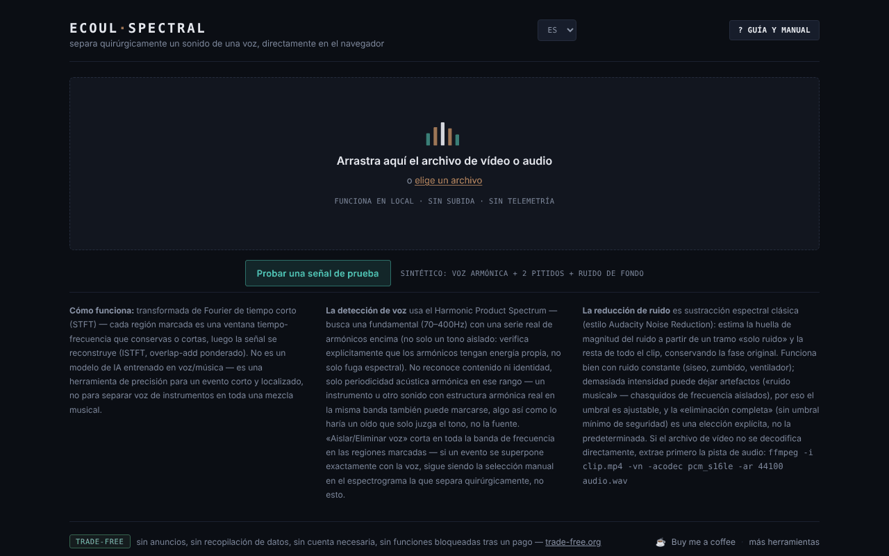

# Ecoul Spectral

[English](README.md) · [Română](README.ro.md) · [Français](README.fr.md) · [Italiano](README.it.md) · **Español** · [Português](README.pt.md) · [Deutsch](README.de.md) · [Magyar](README.hu.md)

**Versión:** 2.0.1 · **Última actualización:** 2026-10-27

**Estado:** estable · **Sin conexión:** completo

Idiomas de la interfaz: **Română, English, Français, Italiano, Español, Português (PT), Deutsch, Magyar**

Separa un sonido de una voz, con precisión quirúrgica, directamente en el navegador — un editor espectral en un único archivo HTML.

**Aplicación en línea:** https://chiuta.github.io/EcoulSpectral/

## Qué es

Ecoul Spectral es un editor de espectrogramas que se ejecuta localmente en el navegador. Cargas un archivo de audio o vídeo, marcas en el espectrograma una región tiempo–frecuencia y luego la aíslas o la eliminas. Incluye detección automática de voz, reducción de ruido y exportación WAV. Según el manual de la aplicación, no es un modelo de IA entrenado: usa la transformada de Fourier de tiempo corto (STFT), la detección de periodicidad (Harmonic Product Spectrum) y la sustracción espectral clásica; no sustituye la separación voz/instrumental en una mezcla musical compleja.

## Funciones

- Carga mediante arrastrar y soltar o «elegir un archivo» (audio o vídeo; si el vídeo no se decodifica, la aplicación muestra un comando ffmpeg para extraer el audio).
- Espectrograma y forma de onda, minimapa de todo el archivo, zoom con la rueda, selección arrastrando, bordes ajustables, campos precisos `t0`, `t1`, `f0`, `f1`.
- «Aislar selección» / «Eliminar selección», «Recortar a la selección», «Fundido de entrada/salida», «Normalizar», «Invertir».
- Deshacer/rehacer (↩ / ↪), bucle sobre la selección, velocidad de reproducción (0,5× – 2×), marcadores («+ marcador en la posición actual»).
- «Eventos automáticos», con componentes Mid (centro) / Side (lateral) y «exportar todos los eventos».
- «Voz automática»: «Aislar la voz» / «Eliminar la voz» en todo el clip, con umbral ajustable.
- «Ruido de fondo»: perfil a partir de la selección, automático (sin voz) o de la porción más silenciosa; «Reducir el ruido (todo el clip)» con intensidad ajustable. El botón está activo justo después de la carga: si no has establecido un perfil, elige uno automáticamente (porciones sin voz, en su defecto la porción más silenciosa) y lo muestra en el estado. Las secciones «Voz automática» y «Ruido de fondo» se abren en la primera carga.
- Comparación A/B, «▶ resultado», «↻ usar como nueva fuente», descarga WAV.
- Guía integrada: «Visita guiada», «Manual», «Atajos».
- «Probar una señal de prueba»: en la pantalla inicial, carga una señal sintética de 8 s generada en el navegador (voz armónica con formantes, dos pitidos de 2,4 kHz y ruido de fondo), para probar la selección, «Aislar la voz» y la reducción de ruido sin un archivo propio. En la primera carga de la sesión se abre la sección «Voz automática».
- Interfaz en 8 idiomas: RO, EN, FR, IT, ES, PT, DE, HU.

## Manual de uso

1. Elige el idioma (RO / EN / FR / IT / ES / PT / DE / HU).
2. Arrastra el archivo de audio/vídeo a la página o pulsa «elegir un archivo».
3. Arrastra con el ratón sobre el espectrograma para marcar una región; ajusta sus bordes o escribe los valores en t0/t1/f0/f1 y pulsa «Establecer selección».
4. Pulsa «Aislar selección» (conservas solo la región) o «Eliminar selección» (la borras). Escucha con «▶ resultado» y compara con «⇄ A/B».
5. Para la voz o el ruido, abre las secciones «Voz automática» / «Ruido de fondo» y elige el perfil de ruido antes de «Reducir el ruido».
6. Si quieres seguir editando sobre el resultado, pulsa «↻ usar como nueva fuente».
7. Descarga el resultado con «⤓ descargar WAV».
8. Atajos (cuando no hay un control deslizante ni una casilla con el foco): **Espacio** reproduce/detiene, **L** bucle sobre la selección, **B** marcador, **U** deshace, **R** rehace, **← →** desplazan la selección (espectrograma con el foco), el doble clic salta al instante, **?** abre la guía, **Esc** la cierra.

## Privacidad y red

- El procesamiento de audio se hace en local; el archivo no se sube a ningún servidor. No he encontrado en el código llamadas `fetch`/XHR ni recursos externos cargados automáticamente.
- **Almacenamiento local:** `localStorage`, clave `ecoulSpectral.settings.v1` (umbrales, intensidad del ruido, idioma, velocidad de reproducción). Los archivos de audio no se guardan.
- Los enlaces del pie de página (Buy Me a Coffee, trade-free.org, chiuta.github.io) solo se abren al hacer clic. Las etiquetas Open Graph del código apuntan a `chiuta.github.io`, sin efecto en la ejecución.

## Requisitos técnicos y límites

- Navegador moderno con Web Audio (`AudioContext`) y canvas; la decodificación de formatos depende de los códecs del navegador.
- El análisis usa una STFT con ventana de 2048 muestras y paso de 512; los archivos de más de 10 minutos piden confirmación antes de cargarse, y su procesamiento puede tardar y consumir mucha memoria.
- La exportación es WAV PCM de 16 bits, con la frecuencia de muestreo de la fuente (mono o estéreo).

## Limitaciones

El eslogan «quirúrgico» describe la precisión de la selección manual sobre el espectrograma, no una separación automática perfecta: la detección de voz se basa en la periodicidad armónica y puede confundir otros sonidos armónicos con la voz, y en una mezcla musical compleja el resultado puede contener artefactos. La muestra `esantion-muzica-voce.wav` del repositorio es un archivo de prueba, no enlazado desde la aplicación. La procedencia y los derechos sobre esta muestra no están documentados en el repositorio (no enlazado desde la aplicación; por confirmar por el autor o eliminar). El eslogan «quirúrgico» (de la meta description, Open Graph y el tagline) se conserva como expresión del autor; su significado es el indicado arriba, y el editor no garantiza una separación perfecta de una voz a partir de una mezcla compleja.

## Ejecución local / sin conexión

Descarga `index.html` y ábrelo en el navegador; no requiere internet. La decodificación de formatos depende de los códecs del navegador.

## Formatos y operaciones (según el código real)

- **Entrada:** cualquier archivo de audio o vídeo que el navegador sepa decodificar (`decodeAudioData`; normalmente WAV, MP3, AAC/M4A, OGG/Opus, FLAC y la pista de audio de MP4/WebM, según los códecs del navegador). Si falla la decodificación, la aplicación muestra un comando ffmpeg. Por encima de 10 minutos pide confirmación. Se conservan todos los canales (mono/estéreo).
- **Análisis:** STFT, ventana de Hann de 2048 muestras, salto de 512.
- **Filtrado/enmascarado:** «Aislar la selección» / «Quitar la selección» (rectángulo tiempo–frecuencia con bordes ajustables, resíntesis por ISTFT con solapamiento y suma).
- **Pincel espectral:** hasta 80 zonas atenuadas (hasta −40 dB, borde suave, deshacer/rehacer ilimitados). El pincel **atenúa**; no «pinta» sonido nuevo ni sintetiza.
- **Voz automática:** detección armónica (Harmonic Product Spectrum, 70–400 Hz) con aislamiento/eliminación en todo el clip.
- **Ruido de fondo:** sustracción espectral, perfil de la selección / automático (sin voz) / tramo más silencioso; «eliminación completa» opcional.
- **Eventos automáticos** con componentes Mid/Side y exportación de todos los eventos; **edición básica:** fundido de entrada/salida, recorte a la selección, normalización, inversión, velocidad 0,5×–2×, marcadores, bucle, comparación A/B.
- **Salida:** WAV PCM de 16 o 24 bits, a la frecuencia de muestreo de la fuente. No exporta MP3/FLAC.

## Capturas de pantalla

El repositorio contiene la captura de la pantalla de inicio. Capturas del espacio de trabajo (selección, voz, ruido): a cargo del autor.

## Historial / Changelog
- **2.0.1 — 2026-10-27:** la descripción (meta, Open Graph, manifiesto, `app.json`) y el README (8 idiomas) indican ahora de forma concreta los formatos y operaciones de la aplicación, según el código; nota «Capturas de pantalla: a cargo del autor»; líneas Estado/Sin conexión; CHANGELOG.md (anterior: v2.0.0).

### 1.2.3 — 2026-10-22

fff-kit 1.1.4: áreas táctiles y texto mínimo.

### 1.2.2 — 2026-10-22

fff-kit 1.1.2: PBKDF2 con 600.000 iteraciones, protección anti-clickjacking.

### 1.2.1 — 2026-10-22

nueva opción **WAV de 24 bits** para el resultado y los clips de eventos (casilla junto al botón de descarga); la confirmación para archivos muy largos es un diálogo integrado en lugar del `confirm()` bloqueante. mejoras para móvil y accesibilidad: texto de al menos 12 px y áreas táctiles de al menos 24 px.

### 1.1.0 — 2026-10-14
- Copia de seguridad y etiquetado de datos (fff-kit).

### 1.0.0 — 12 de octubre de 2026
- La versión y la fecha de la última actualización se muestran en la aplicación (pie de página).

### 11.10.2026 (tercera actualización) — 11 de octubre de 2026
- Corregido: los botones de reducción de ruido no se podían pulsar sin pasos adicionales (la sección estaba cerrada y «Reducir el ruido» permanecía desactivado hasta establecer un perfil). Ahora la sección se abre en la primera carga, el botón está activo y la falta de perfil se resuelve automáticamente (el mensaje de estado, traducido a los 7 idiomas, lo indica).

### 11.10.2026 (segunda actualización) — 11 de octubre de 2026
- Pantalla inicial: el botón «Probar una señal de prueba» (señal sintética generada en local; textos en los 7 idiomas). La sección «Voz automática» se abre en la primera carga.
- Documentación: nueva sección «Requisitos técnicos y límites».

### 11.10.2026 — 11 de octubre de 2026
- Accesibilidad: encabezado h1 (wordmark), zona principal (main) alrededor del área de carga/espacio de trabajo; verificación axe sin infracciones a 1280 y 360 px.
- Añadida una Content-Security-Policy estricta (script con hash; sin conexiones de red, solo blob:/data:).

## Licencia

MIT para el código y la estructura de la aplicación — véase el archivo `LICENSE`. Las eventuales bibliotecas de terceros incluidas en el archivo conservan sus propias licencias. El archivo de prueba `esantion-muzica-voce.wav` no forma parte de esta dedicatoria; los derechos sobre él quedan reservados hasta una declaración aparte.

## Autor

Alexio — Alexandru-Ionuț Chiuță, contacto: alexio@trom.tf.

## Resumen

Ecoul Spectral es un editor de espectrogramas de un único archivo, en el navegador: selecciona una región tiempo-frecuencia y aíslala o elimínala, detecta o elimina la voz (harmonic product spectrum), reduce el ruido (sustracción espectral) y exporta en WAV. Usa procesamiento de señal clásico, no un modelo de IA entrenado. El audio nunca sale del navegador; solo los ajustes se guardan en localStorage. Interfaz en 8 idiomas. Licencia: MIT.

Auditoría: 2026-10-10 (ronda 2, 2026-10-11: eslogan y muestra .wav solo documentados, sin cambios en la aplicación) — verificado el código (sin llamadas de red), la accesibilidad (axe: contraste corregido) y el funcionamiento (carga WAV, aislamiento de la selección, aislamiento de la voz).
