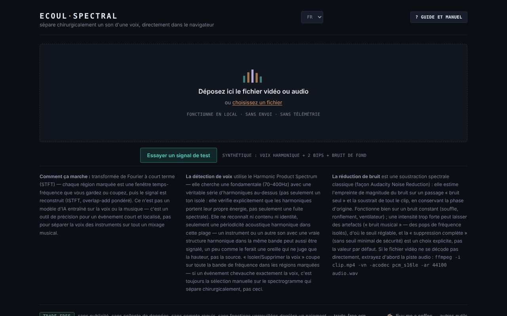

# Ecoul Spectral

[English](README.md) · [Română](README.ro.md) · **Français** · [Italiano](README.it.md) · [Español](README.es.md) · [Português](README.pt.md) · [Deutsch](README.de.md) · [Magyar](README.hu.md)

**Version :** 2.1.0 · **Dernière mise à jour :** 2026-10-27

**État:** stable · **Hors ligne:** complet

Langues de l'interface : **Română, English, Français, Italiano, Español, Português (PT), Deutsch, Magyar**

Séparez un son d'une voix, avec une précision chirurgicale, directement dans le navigateur — un éditeur spectral en un seul fichier HTML.

**Application en ligne :** https://chiuta.github.io/EcoulSpectral/

## Ce que c'est

Ecoul Spectral est un éditeur de spectrogramme qui s'exécute localement dans le navigateur. Vous chargez un fichier audio ou vidéo, vous marquez sur le spectrogramme une région temps–fréquence, puis vous l'isolez ou la supprimez. Il comprend la détection automatique de la voix, la réduction du bruit et l'export WAV. Selon le manuel de l'application, ce n'est pas un modèle d'IA entraîné : il utilise la transformée de Fourier à court terme (STFT), la détection de périodicité (Harmonic Product Spectrum) et la soustraction spectrale classique ; il ne remplace pas la séparation voix/instrumental sur un mix musical complexe.

## Fonctionnalités

- Chargement par glisser-déposer ou « choisir un fichier » (audio ou vidéo ; si la vidéo ne se décode pas, l'application affiche une commande ffmpeg pour extraire l'audio).
- Spectrogramme et forme d'onde, minicarte pour tout le fichier, zoom à la molette, sélection par glissement, bords réglables, champs précis `t0`, `t1`, `f0`, `f1`.
- « Isoler la sélection » / « Supprimer la sélection », « Rogner à la sélection », « Fondu entrant/sortant », « Normaliser », « Inverser ».
- Annuler/rétablir (↩ / ↪), boucle sur la sélection, vitesse de lecture (0,5× – 2×), repères (« + repère à la position courante »).
- « Événements automatiques », avec composantes Mid (centre) / Side (côté) et « exporter tous les événements ».
- « Voix automatique » : « Isoler la voix » / « Supprimer la voix » sur tout le clip, avec un seuil réglable.
- « Bruit de fond » : profil à partir de la sélection, automatique (sans voix) ou à partir de la portion la plus calme ; « Réduire le bruit (tout le clip) » avec une intensité réglable. Le bouton est actif dès le chargement : si vous n'avez pas défini de profil, il en choisit un automatiquement (portions sans voix, sinon la portion la plus calme) et l'affiche dans l'état. Les sections « Voix automatique » et « Bruit de fond » s'ouvrent au premier chargement.
- Comparaison A/B, « ▶ résultat », « ↻ utiliser comme nouvelle source », téléchargement WAV.
- Guide intégré : « Visite guidée », « Manuel », « Raccourcis ».
- « Essayer un signal de test » : sur l'écran initial, charge un signal synthétique de 8 s généré dans le navigateur (voix harmonique avec formants, deux bips à 2,4 kHz et bruit de fond), afin d'essayer la sélection, « Isoler la voix » et la réduction du bruit sans fichier personnel. Au premier chargement de la session, la section « Voix automatique » s'ouvre.
- Interface en 8 langues : RO, EN, FR, IT, ES, PT, DE, HU.

## Mode d'emploi

1. Choisissez la langue (RO / EN / FR / IT / ES / PT / DE / HU).
2. Glissez le fichier audio/vidéo sur la page ou appuyez sur « choisir un fichier ».
3. Faites glisser la souris sur le spectrogramme pour marquer une région ; ajustez ses bords ou saisissez les valeurs dans t0/t1/f0/f1 et appuyez sur « Définir la sélection ».
4. Appuyez sur « Isoler la sélection » (vous ne gardez que la région) ou « Supprimer la sélection » (vous l'effacez). Écoutez avec « ▶ résultat » et comparez avec « ⇄ A/B ».
5. Pour la voix ou le bruit, ouvrez les sections « Voix automatique » / « Bruit de fond » et choisissez le profil de bruit avant « Réduire le bruit ».
6. Si vous voulez continuer l'édition sur le résultat, appuyez sur « ↻ utiliser comme nouvelle source ».
7. Téléchargez le résultat avec « ⤓ télécharger WAV ».
8. Raccourcis (lorsqu'aucun curseur ni aucune case n'a le focus) : **Espace** lit/arrête, **L** boucle sur la sélection, **B** repère, **U** annule, **R** rétablit, **← →** déplacent la sélection (spectrogramme ayant le focus), le double-clic saute à l'instant, **?** ouvre le guide, **Échap** le ferme.

## Confidentialité et réseau

- Le traitement audio se fait en local ; le fichier n'est téléversé sur aucun serveur. Je n'ai trouvé dans le code aucun appel `fetch`/XHR ni ressource externe chargée automatiquement.
- **Stockage local :** `localStorage`, clé `ecoulSpectral.settings.v1` (seuils, intensité du bruit, langue, vitesse de lecture). Les fichiers audio ne sont pas enregistrés.
- Les liens du pied de page (Buy Me a Coffee, trade-free.org, chiuta.github.io) ne s'ouvrent qu'au clic. Les balises Open Graph du code pointent vers `chiuta.github.io`, sans effet à l'exécution.

## Exigences techniques et limites

- Navigateur moderne avec Web Audio (`AudioContext`) et canvas ; le décodage des formats dépend des codecs du navigateur.
- L'analyse utilise une STFT avec une fenêtre de 2048 échantillons et un pas de 512 ; les fichiers de plus de 10 minutes demandent une confirmation avant le chargement, et leur traitement peut être long et consommer beaucoup de mémoire.
- L'export est un WAV PCM 16 bits, à la fréquence d'échantillonnage de la source (mono ou stéréo).

## Limitations

Le slogan « chirurgical » décrit la précision de la sélection manuelle sur le spectrogramme, et non une séparation automatique parfaite : la détection de la voix repose sur la périodicité harmonique et peut confondre d'autres sons harmoniques avec la voix, et sur un mix musical complexe le résultat peut contenir des artefacts. L'échantillon `esantion-muzica-voce.wav` du dépôt est un fichier d'essai, non relié depuis l'application. La provenance et les droits sur cet échantillon ne sont pas documentés dans le dépôt (non relié depuis l'application ; à confirmer par l'auteur ou à supprimer). Le slogan « chirurgical » (issu de la meta description, d'Open Graph et du tagline) est conservé comme expression de l'auteur ; sa signification est celle indiquée ci-dessus, et l'éditeur ne garantit pas une séparation parfaite d'une voix à partir d'un mix complexe.

## Exécution locale / hors ligne

Téléchargez `index.html` et ouvrez-le dans le navigateur ; aucune connexion internet n'est nécessaire. Le décodage des formats dépend des codecs du navigateur.

## Formats et opérations (d’après le code réel)

- **Entrée :** tout fichier audio ou vidéo que le navigateur sait décoder (`decodeAudioData` ; en général WAV, MP3, AAC/M4A, OGG/Opus, FLAC et la piste audio de MP4/WebM, selon les codecs du navigateur). Si le décodage échoue, l’application affiche une commande ffmpeg. Au-delà de 10 minutes, une confirmation est demandée. Tous les canaux (mono/stéréo) sont conservés.
- **Analyse :** STFT, fenêtre de Hann de 2048 échantillons, pas de 512.
- **Filtrage/masquage :** « Isoler la sélection » / « Supprimer la sélection » (rectangle temps–fréquence à bords réglables, resynthèse par ISTFT avec recouvrement-addition).
- **Pinceau spectral :** jusqu’à 80 zones atténuées (jusqu’à −40 dB, bord doux, annulation/rétablissement illimités). Le pinceau **atténue**. Depuis 2.1.0, la **peinture spectrale** ajoute un son synthétique (ton = une sinusoïde par bin, ou bruit à bande limitée) dans le rectangle sélectionné, à un niveau RMS choisi plafonné à −12 dBFS ; elle ajoute du son nouveau et ne récupère aucune information perdue. Nouveaux aussi : **segments** (intervalles étiquetés : écoute, WAV, export CSV/JSON) et **comparaison de deux enregistrements** (spectre moyen en tiers d’octave, dBFS non calibré). Textes nouveaux en RO/EN, anglais pour les autres langues.
- **Voix automatique :** détection harmonique (Harmonic Product Spectrum, 70–400 Hz) avec isolation/suppression sur tout le clip.
- **Bruit de fond :** soustraction spectrale, profil issu de la sélection / automatique (sans voix) / passage le plus silencieux ; « suppression complète » en option.
- **Événements automatiques** avec composantes Mid/Side et export de tous les événements ; **édition de base :** fondu entrant/sortant, recadrage sur la sélection, normalisation, inversion, vitesse 0,5×–2×, repères, boucle, comparaison A/B.
- **Sortie :** WAV PCM 16 ou 24 bits, à la fréquence d’échantillonnage de la source. Pas d’export MP3/FLAC.

## Captures d’écran

Le dépôt contient la capture de l’écran d’accueil. Captures de l’espace de travail (sélection, voix, bruit) : à ajouter par l’auteur.

## Historique / Changelog
- **2.1.0 — 2026-10-27:** spectral paint, segments with CSV/JSON/WAV export, two-recording comparison (details: CHANGELOG.md).
- **2.0.1 — 2026-10-27 :** la description (meta, Open Graph, manifeste, `app.json`) et le README (8 langues) indiquent désormais concrètement les formats et opérations de l’application, d’après le code ; note « Captures d’écran : à ajouter par l’auteur » ; lignes État/Hors ligne ; CHANGELOG.md (précédente : v2.0.0).

### 1.2.3 — 2026-10-22

fff-kit 1.1.4 : cibles tactiles et taille de texte minimale.

### 1.2.2 — 2026-10-22

fff-kit 1.1.2 : PBKDF2 600 000 itérations, protection anti-clickjacking.

### 1.2.1 — 2026-10-22

nouvelle option **WAV 24 bits** pour le résultat et les clips d’événements (case à côté du bouton de téléchargement) ; la confirmation pour les fichiers très longs est une boîte de dialogue intégrée au lieu du `confirm()` bloquant. finitions mobile et accessibilité : texte d’au moins 12 px et cibles tactiles d’au moins 24 px.

### 1.1.0 — 2026-10-14
- Sauvegarde et étiquetage des données (fff-kit).

### 1.0.0 — 12 octobre 2026
- La version et la date de la dernière mise à jour sont affichées dans l'application (pied de page).

### 11.10.2026 (troisième mise à jour) — 11 octobre 2026
- Corrigé : les boutons de réduction du bruit ne pouvaient pas être pressés sans étapes supplémentaires (la section était fermée, et « Réduire le bruit » restait désactivé tant qu'aucun profil n'était défini). Désormais la section s'ouvre au premier chargement, le bouton est actif, et l'absence de profil se résout automatiquement (le message d'état, traduit dans les 7 langues, l'indique).

### 11.10.2026 (deuxième mise à jour) — 11 octobre 2026
- Écran initial : le bouton « Essayer un signal de test » (signal synthétique généré en local ; textes dans les 7 langues). La section « Voix automatique » s'ouvre au premier chargement.
- Documentation : nouvelle section « Exigences techniques et limites ».

### 11.10.2026 — 11 octobre 2026
- Accessibilité : titre h1 (wordmark), zone principale (main) autour de la zone de chargement/de l'espace de travail ; vérification axe sans violation à 1280 et 360 px.
- Ajout d'une Content-Security-Policy stricte (script avec hachage ; aucune connexion réseau, uniquement blob:/data:).

## Licence

MIT pour le code et la structure de l'application — voir le fichier `LICENSE`. Les éventuelles bibliothèques tierces incluses dans le fichier conservent leurs propres licences. Le fichier d'essai `esantion-muzica-voce.wav` ne fait pas partie de cette dédicace ; les droits sur celui-ci restent réservés jusqu'à une déclaration distincte.

## Auteur

Alexio — Alexandru-Ionuț Chiuță, contact : alexio@trom.tf.

## Résumé
Ecoul Spectral est un éditeur de spectrogramme en un seul fichier, dans le navigateur : sélectionnez une région temps-fréquence et isolez-la ou supprimez-la, détectez ou supprimez la voix (harmonic product spectrum), réduisez le bruit (soustraction spectrale), puis exportez en WAV. Il utilise du traitement du signal classique, et non un modèle d'IA entraîné. L'audio ne quitte jamais le navigateur ; seuls les réglages sont conservés dans localStorage. Interface en 8 langues. Licence : MIT.

Audit : 2026-10-10 (tour 2, 2026-10-11 : slogan et échantillon .wav seulement documentés, sans modification de l'application) — code vérifié (aucun appel réseau), accessibilité (axe : contraste corrigé) et fonctionnement (chargement WAV, isolation de la sélection, isolation de la voix).
