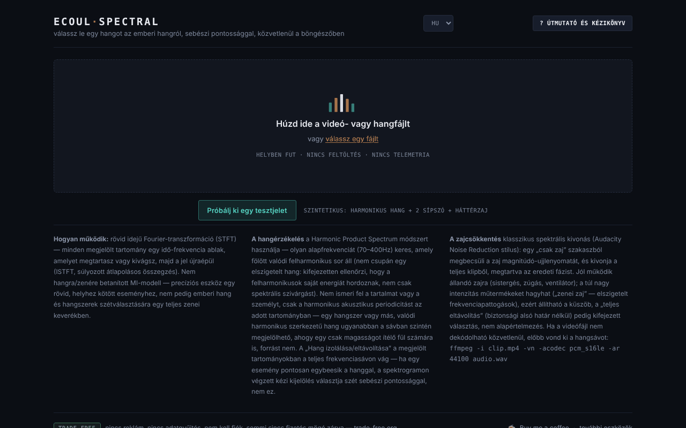

# Ecoul Spectral

[English](README.md) · [Română](README.ro.md) · [Français](README.fr.md) · [Italiano](README.it.md) · [Español](README.es.md) · [Português](README.pt.md) · [Deutsch](README.de.md) · **Magyar**

**Verzió:** 1.2.0 · **Utolsó frissítés:** 2026-10-19

A felület nyelvei: **Română, English, Français, Italiano, Español, Português (PT), Deutsch, Magyar**

Válassz el egy hangot egy hangtól, sebészi pontossággal, közvetlenül a böngészőben — spektrálszerkesztő egyetlen HTML-fájlban.

**Online alkalmazás:** https://chiuta.github.io/EcoulSpectral/

## Mi ez

Az Ecoul Spectral egy spektrogramszerkesztő, amely helyben fut a böngészőben. Betöltesz egy hang- vagy videófájlt, a spektrogramon megjelölsz egy idő–frekvencia tartományt, majd elkülöníted vagy eltávolítod. Tartalmaz automatikus hangfelismerést (emberi hang), zajcsökkentést és WAV-exportot. Az alkalmazás kézikönyve szerint nem tanított MI-modell: a rövid idejű Fourier-transzformációt (STFT), a periodicitás-felismerést (Harmonic Product Spectrum) és a klasszikus spektrális kivonást használja; nem helyettesíti az ének/hangszeres szétválasztást összetett zenei keverékeken.

## Funkciók

- Betöltés húzással vagy a „válassz egy fájlt” gombbal (hang vagy videó; ha a videó nem dekódolható, az alkalmazás egy ffmpeg-parancsot jelenít meg a hang kinyeréséhez).
- Spektrogram és hullámforma, minitérkép a teljes fájlhoz, nagyítás görgővel, kijelölés húzással, állítható szélek, pontos mezők: `t0`, `t1`, `f0`, `f1`.
- „Kijelölés elkülönítése” / „Kijelölés eltávolítása”, „Vágás a kijelölésre”, „Be-/kihalkítás”, „Normalizálás”, „Megfordítás”.
- Visszavonás/újra (↩ / ↪), ismétlés a kijelölésen, lejátszási sebesség (0,5× – 2×), jelölők („+ jelölő az aktuális pozíción”).
- „Automatikus események”, Mid (közép) / Side (oldalsó) komponensekkel és „összes esemény exportálása”.
- „Automatikus hang”: „Hang elkülönítése” / „Hang eltávolítása” a teljes klipen, állítható küszöbbel.
- „Háttérzaj”: profil a kijelölésből, automatikus (hang nélküli) vagy a leghalkabb szakaszból; „Zaj csökkentése (teljes klip)” állítható erősséggel. A gomb a betöltés után azonnal aktív: ha nem állítottál be profilt, automatikusan választ egyet (hang nélküli szakaszok, ennek hiányában a leghalkabb szakasz), és az állapotsorban megjeleníti. Az „Automatikus hang” és a „Háttérzaj” szakasz az első betöltéskor kinyílik.
- A/B-összehasonlítás, „▶ eredmény”, „↻ használat új forrásként”, WAV-letöltés.
- Beépített súgó: „Vezetett bemutató”, „Kézikönyv”, „Billentyűparancsok”.
- „Próbáld ki egy tesztjellel”: a kezdőképernyőn betölt egy 8 másodperces, a böngészőben generált szintetikus jelet (harmonikus hang formánsokkal, két 2,4 kHz-es sípszó és háttérzaj), hogy saját fájl nélkül kipróbálhasd a kijelölést, a „Hang elkülönítése” funkciót és a zajcsökkentést. A munkamenet első betöltésekor az „Automatikus hang” szakasz kinyílik.
- Felület 8 nyelven: RO, EN, FR, IT, ES, PT, DE, HU.

## Használati útmutató

1. Válaszd ki a nyelvet (RO / EN / FR / IT / ES / PT / DE / HU).
2. Húzd a hang-/videófájlt az oldalra, vagy nyomd meg a „válassz egy fájlt” gombot.
3. Húzz az egérrel a spektrogramon egy tartomány megjelöléséhez; állítsd be a széleit, vagy írd be az értékeket a t0/t1/f0/f1 mezőkbe, és nyomd meg a „Kijelölés beállítása” gombot.
4. Nyomd meg a „Kijelölés elkülönítése” (csak a tartományt tartod meg) vagy a „Kijelölés eltávolítása” (törlöd) gombot. Hallgasd meg a „▶ eredmény” gombbal, és hasonlítsd össze a „⇄ A/B” gombbal.
5. Hanghoz vagy zajhoz nyisd meg az „Automatikus hang” / „Háttérzaj” szakaszokat, és válaszd ki a zajprofilt a „Zaj csökkentése” előtt.
6. Ha az eredményen szeretnéd folytatni a szerkesztést, nyomd meg a „↻ használat új forrásként” gombot.
7. Töltsd le az eredményt a „⤓ WAV letöltése” gombbal.
8. Billentyűparancsok (ha nincs fókuszban csúszka vagy mező): **Szóköz** lejátszás/leállítás, **L** ismétlés a kijelölésen, **B** jelölő, **U** visszavonás, **R** újra, **← →** a kijelölés mozgatása (fókuszban lévő spektrogram), dupla kattintás az adott pillanatra ugrik, **?** megnyitja a súgót, **Esc** bezárja.

## Adatvédelem és hálózat

- A hangfeldolgozás helyben történik; a fájl nem kerül fel semmilyen szerverre. A kódban nem találtam `fetch`/XHR hívásokat vagy automatikusan betöltött külső erőforrásokat.
- **Helyi tárolás:** `localStorage`, `ecoulSpectral.settings.v1` kulcs (küszöbök, zajerősség, nyelv, lejátszási sebesség). A hangfájlokat nem menti.
- A lábléc hivatkozásai (Buy Me a Coffee, trade-free.org, chiuta.github.io) csak kattintásra nyílnak meg. A kódban lévő Open Graph címkék a `chiuta.github.io`-ra mutatnak, futásidőben hatástalanok.

## Műszaki követelmények és korlátok

- Modern böngésző Web Audio-val (`AudioContext`) és canvasszal; a formátumok dekódolása a böngésző kodekjeitől függ.
- Az elemzés 2048 mintás ablakú és 512-es lépésközű STFT-t használ; a 10 percnél hosszabb fájlok betöltés előtt megerősítést kérnek, feldolgozásuk sokáig tarthat és sok memóriát használhat.
- Az export 16 bites PCM WAV, a forrás mintavételi frekvenciájával (mono vagy sztereó).

## Korlátozások

A „sebészi” szlogen a spektrogramon végzett kézi kijelölés pontosságát írja le, nem tökéletes automatikus szétválasztást: a hangfelismerés a harmonikus periodicitásra épül, és összetéveszthet más harmonikus hangokat az emberi hanggal, összetett zenei keveréken pedig az eredmény műtermékeket tartalmazhat. A tárolóban lévő `esantion-muzica-voce.wav` minta próbafájl, az alkalmazásból nincs hivatkozva. E minta eredete és jogai nincsenek dokumentálva a tárolóban (az alkalmazásból nincs hivatkozva; a szerzőnek meg kell erősítenie, vagy el kell távolítani). A „sebészi” szlogent (a meta descriptionből, az Open Graphból és a taglineból) a szerző kifejezéseként megtartottuk; jelentése a fent leírt, és a szerkesztő nem garantálja egy hang tökéletes szétválasztását egy összetett keverékből.

## Helyi / offline futtatás

Töltsd le az `index.html` fájlt, és nyisd meg böngészőben; nem igényel internetet. A formátumok dekódolása a böngésző kodekjeitől függ.

## Előzmények / Changelog

### 1.1.0 — 2026-10-14
- Biztonsági mentés és adatcímkézés (fff-kit).

### 1.0.0 — 2026. október 12.
- A verzió és az utolsó frissítés dátuma megjelenik az alkalmazásban (lábléc).

### 11.10.2026 (harmadik frissítés) — 2026. október 11.
- Javítva: a zajcsökkentő gombok nem voltak megnyomhatók további lépések nélkül (a szakasz zárva volt, és a „Zaj csökkentése” letiltva maradt, amíg nem állítottak be profilt). Mostantól a szakasz az első betöltéskor kinyílik, a gomb aktív, a hiányzó profil pedig automatikusan megoldódik (az állapotüzenet, 7 nyelvre lefordítva, ezt jelzi).

### 11.10.2026 (második frissítés) — 2026. október 11.
- Kezdőképernyő: a „Próbáld ki egy tesztjellel” gomb (helyben generált szintetikus jel; szövegek mind a 7 nyelven). Az „Automatikus hang” szakasz az első betöltéskor kinyílik.
- Dokumentáció: új szakasz: „Műszaki követelmények és korlátok”.

### 11.10.2026 — 2026. október 11.
- Akadálymentesség: h1 címsor (wordmark), főterület (main) a betöltési terület/munkaterület körül; axe-ellenőrzés szabálysértés nélkül 1280 és 360 px-en.
- Szigorú Content-Security-Policy hozzáadva (hash-sel ellátott szkript; hálózati kapcsolatok nélkül, csak blob:/data:).

## Licenc

MIT az alkalmazás kódjára és szerkezetére — lásd a `LICENSE` fájlt. A fájlba esetlegesen beépített harmadik féltől származó könyvtárak megtartják saját licencüket. Az `esantion-muzica-voce.wav` próbafájl nem része ennek az ajánlásnak; a rá vonatkozó jogok külön nyilatkozatig fenntartottak.

## Szerző

Alexio — Alexandru-Ionuț Chiuță, kapcsolat: alexio@trom.tf.

## Angol nyelvű összefoglaló

Az Ecoul Spectral egyetlen fájlból álló spektrogramszerkesztő a böngészőben: jelölj ki egy idő–frekvencia tartományt, és különítsd el vagy távolítsd el, ismerd fel vagy távolítsd el az emberi hangot (harmonic product spectrum), csökkentsd a zajt (spektrális kivonás), majd exportálj WAV-ba. Klasszikus jelfeldolgozást használ, nem tanított MI-modellt. A hang soha nem hagyja el a böngészőt; csak a beállítások maradnak a localStorage-ban. Felület 8 nyelven. Licenc: MIT.

Audit: 2026-10-10 (2. kör, 2026-10-11: a szlogen és a .wav minta csak dokumentálva, az alkalmazásban nincs módosítás) — ellenőrizve a kód (hálózati hívások nélkül), az akadálymentesség (axe: a kontraszt javítva) és a működés (WAV betöltése, kijelölés elkülönítése, hang elkülönítése).
