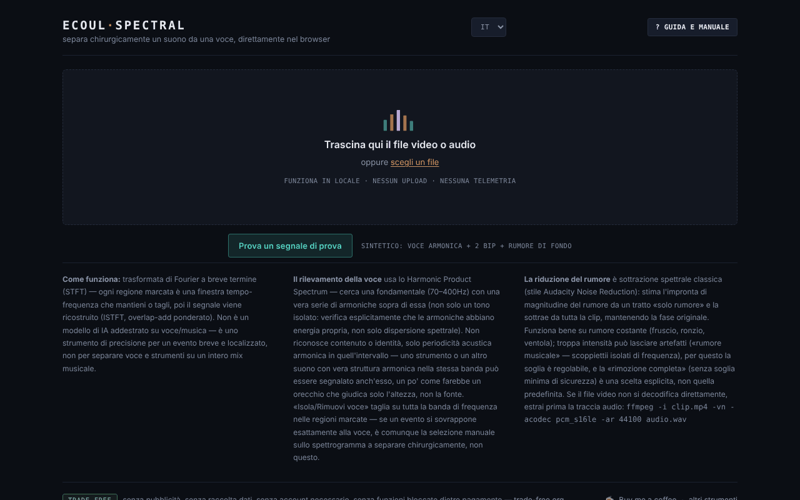

# Ecoul Spectral

[English](README.md) · [Română](README.ro.md) · [Français](README.fr.md) · **Italiano** · [Español](README.es.md) · [Português](README.pt.md) · [Deutsch](README.de.md) · [Magyar](README.hu.md)

**Versione:** 2.0.1 · **Ultimo aggiornamento:** 2026-10-27

**Stato:** stabile · **Offline:** completo

Lingue dell'interfaccia: **Română, English, Français, Italiano, Español, Português (PT), Deutsch, Magyar**

Separa un suono da una voce, con precisione chirurgica, direttamente nel browser — un editor spettrale in un unico file HTML.

**Applicazione online:** https://chiuta.github.io/EcoulSpectral/

## Che cos'è

Ecoul Spectral è un editor di spettrogrammi che gira in locale nel browser. Carichi un file audio o video, segni sullo spettrogramma una regione tempo–frequenza, poi la isoli o la rimuovi. Include il rilevamento automatico della voce, la riduzione del rumore e l'esportazione WAV. Secondo il manuale dell'applicazione, non è un modello di IA addestrato: usa la trasformata di Fourier a breve termine (STFT), il rilevamento della periodicità (Harmonic Product Spectrum) e la classica sottrazione spettrale; non sostituisce la separazione voce/strumentale su un mix musicale complesso.

## Funzioni

- Caricamento tramite trascinamento o «scegli un file» (audio o video; se il video non si decodifica, l'applicazione mostra un comando ffmpeg per estrarre l'audio).
- Spettrogramma e forma d'onda, minimappa per tutto il file, zoom con la rotellina, selezione trascinando, bordi regolabili, campi precisi `t0`, `t1`, `f0`, `f1`.
- «Isola selezione» / «Rimuovi selezione», «Ritaglia alla selezione», «Dissolvenza in entrata/uscita», «Normalizza», «Inverti».
- Annulla/ripristina (↩ / ↪), loop sulla selezione, velocità di riproduzione (0,5× – 2×), marcatori («+ marcatore alla posizione corrente»).
- «Eventi automatici», con componenti Mid (centro) / Side (laterale) ed «esporta tutti gli eventi».
- «Voce automatica»: «Isola la voce» / «Rimuovi la voce» su tutta la clip, con soglia regolabile.
- «Rumore di fondo»: profilo dalla selezione, automatico (senza voce) o dalla porzione più silenziosa; «Riduci il rumore (tutta la clip)» con intensità regolabile. Il pulsante è attivo subito dopo il caricamento: se non hai impostato un profilo, ne sceglie automaticamente uno (porzioni senza voce, altrimenti la porzione più silenziosa) e lo mostra nello stato. Le sezioni «Voce automatica» e «Rumore di fondo» si aprono al primo caricamento.
- Confronto A/B, «▶ risultato», «↻ usa come nuova sorgente», download WAV.
- Guida integrata: «Tour guidato», «Manuale», «Scorciatoie».
- «Prova un segnale di test»: nella schermata iniziale carica un segnale sintetico di 8 s generato nel browser (voce armonica con formanti, due beep a 2,4 kHz e rumore di fondo), per provare la selezione, «Isola la voce» e la riduzione del rumore senza un file proprio. Al primo caricamento della sessione si apre la sezione «Voce automatica».
- Interfaccia in 8 lingue: RO, EN, FR, IT, ES, PT, DE, HU.

## Guida all'uso

1. Scegli la lingua (RO / EN / FR / IT / ES / PT / DE / HU).
2. Trascina il file audio/video sulla pagina o premi «scegli un file».
3. Trascina con il mouse sullo spettrogramma per segnare una regione; regola i bordi o scrivi i valori in t0/t1/f0/f1 e premi «Imposta selezione».
4. Premi «Isola selezione» (mantieni solo la regione) o «Rimuovi selezione» (la cancelli). Ascolta con «▶ risultato» e confronta con «⇄ A/B».
5. Per la voce o il rumore, apri le sezioni «Voce automatica» / «Rumore di fondo» e scegli il profilo di rumore prima di «Riduci il rumore».
6. Se vuoi continuare a modificare il risultato, premi «↻ usa come nuova sorgente».
7. Scarica il risultato con «⤓ scarica WAV».
8. Scorciatoie (quando nessun cursore o casella ha il focus): **Spazio** riproduce/ferma, **L** loop sulla selezione, **B** marcatore, **U** annulla, **R** ripristina, **← →** spostano la selezione (spettrogramma con il focus), il doppio clic salta al momento, **?** apre la guida, **Esc** la chiude.

## Privacy e rete

- L'elaborazione audio avviene in locale; il file non viene caricato su alcun server. Nel codice non ho trovato chiamate `fetch`/XHR né risorse esterne caricate automaticamente.
- **Archiviazione locale:** `localStorage`, chiave `ecoulSpectral.settings.v1` (soglie, intensità del rumore, lingua, velocità di riproduzione). I file audio non vengono salvati.
- I link nel piè di pagina (Buy Me a Coffee, trade-free.org, chiuta.github.io) si aprono solo al clic. I tag Open Graph nel codice puntano a `chiuta.github.io`, senza effetto in esecuzione.

## Requisiti tecnici e limiti

- Browser moderno con Web Audio (`AudioContext`) e canvas; la decodifica dei formati dipende dai codec del browser.
- L'analisi usa una STFT con finestra di 2048 campioni e passo di 512; i file più lunghi di 10 minuti richiedono conferma prima del caricamento, e la loro elaborazione può richiedere tempo e consumare molta memoria.
- L'esportazione è WAV PCM a 16 bit, con la frequenza di campionamento della sorgente (mono o stereo).

## Limitazioni

Lo slogan «chirurgico» descrive la precisione della selezione manuale sullo spettrogramma, non una separazione automatica perfetta: il rilevamento della voce si basa sulla periodicità armonica e può confondere altri suoni armonici con la voce, e su un mix musicale complesso il risultato può contenere artefatti. Il campione `esantion-muzica-voce.wav` nel repository è un file di prova, non collegato dall'applicazione. La provenienza e i diritti su questo campione non sono documentati nel repository (non collegato dall'applicazione; da confermare dall'autore o da rimuovere). Lo slogan «chirurgico» (dalla meta description, da Open Graph e dal tagline) è mantenuto come espressione dell'autore; il suo significato è quello sopra indicato, e l'editor non garantisce una separazione perfetta di una voce da un mix complesso.

## Esecuzione locale / offline

Scarica `index.html` e aprilo nel browser; non richiede internet. La decodifica dei formati dipende dai codec del browser.

## Formati e operazioni (dal codice reale)

- **Ingresso:** qualsiasi file audio o video che il browser sappia decodificare (`decodeAudioData`; di norma WAV, MP3, AAC/M4A, OGG/Opus, FLAC e la traccia audio di MP4/WebM, secondo i codec del browser). Se la decodifica fallisce, l’app mostra un comando ffmpeg. Oltre 10 minuti chiede conferma. Tutti i canali (mono/stereo) sono mantenuti.
- **Analisi:** STFT, finestra di Hann di 2048 campioni, passo 512.
- **Filtraggio/mascheratura:** «Isola la selezione» / «Rimuovi la selezione» (rettangolo tempo–frequenza con bordi regolabili, risintesi con ISTFT e overlap-add).
- **Pennello spettrale:** fino a 80 aree attenuate (fino a −40 dB, bordo morbido, annulla/ripeti illimitati). Il pennello **attenua**; non «dipinge» suono nuovo e non sintetizza.
- **Voce automatica:** rilevamento armonico (Harmonic Product Spectrum, 70–400 Hz) con isolamento/rimozione su tutta la clip.
- **Rumore di fondo:** sottrazione spettrale, profilo dalla selezione / automatico (senza voce) / tratto più silenzioso; «rimozione completa» opzionale.
- **Eventi automatici** con componenti Mid/Side ed esportazione di tutti gli eventi; **modifica di base:** dissolvenza in/out, ritaglio sulla selezione, normalizzazione, inversione, velocità 0,5×–2×, marcatori, loop, confronto A/B.
- **Uscita:** WAV PCM a 16 o 24 bit, alla frequenza di campionamento della sorgente. Non esporta MP3/FLAC.

## Schermate

Il repository contiene la schermata iniziale. Schermate dell’area di lavoro (selezione, voce, rumore): da aggiungere a cura dell’autore.

## Cronologia / Changelog
- **2.0.1 — 2026-10-27:** la descrizione (meta, Open Graph, manifest, `app.json`) e il README (8 lingue) indicano ora in concreto formati e operazioni dell’app, in base al codice; nota «Schermate: da aggiungere a cura dell’autore»; righe Stato/Offline; CHANGELOG.md (precedente: v2.0.0).

### 1.2.3 — 2026-10-22

fff-kit 1.1.4: aree tattili e testo minimo.

### 1.2.2 — 2026-10-22

fff-kit 1.1.2: PBKDF2 a 600.000 iterazioni, protezione anti-clickjacking.

### 1.2.1 — 2026-10-22

nuova opzione **WAV a 24 bit** per il risultato e i clip degli eventi (casella accanto al pulsante di download); la conferma per i file molto lunghi è una finestra in linea invece del `confirm()` bloccante. rifiniture per mobile e accessibilità: testo di almeno 12 px e aree tattili di almeno 24 px.

### 1.1.0 — 2026-10-14
- Copia di riserva ed etichettatura dei dati (fff-kit).

### 1.0.0 — 12 ottobre 2026
- La versione e la data dell'ultimo aggiornamento sono mostrate nell'applicazione (piè di pagina).

### 11.10.2026 (terzo aggiornamento) — 11 ottobre 2026
- Corretto: i pulsanti di riduzione del rumore non potevano essere premuti senza passaggi aggiuntivi (la sezione era chiusa, e «Riduci il rumore» restava disattivato finché non veniva impostato un profilo). Ora la sezione si apre al primo caricamento, il pulsante è attivo, e la mancanza del profilo si risolve automaticamente (il messaggio di stato, tradotto nelle 7 lingue, lo dice).

### 11.10.2026 (secondo aggiornamento) — 11 ottobre 2026
- Schermata iniziale: il pulsante «Prova un segnale di test» (segnale sintetico generato in locale; testi in tutte e 7 le lingue). La sezione «Voce automatica» si apre al primo caricamento.
- Documentazione: nuova sezione «Requisiti tecnici e limiti».

### 11.10.2026 — 11 ottobre 2026
- Accessibilità: titolo h1 (wordmark), area principale (main) attorno all'area di caricamento/spazio di lavoro; verifica axe senza violazioni a 1280 e 360 px.
- Aggiunta una Content-Security-Policy rigorosa (script con hash; nessuna connessione di rete, solo blob:/data:).

## Licenza

MIT per il codice e la struttura dell'applicazione — vedi il file `LICENSE`. Le eventuali librerie di terze parti incluse nel file mantengono le proprie licenze. Il file di prova `esantion-muzica-voce.wav` non fa parte di questa dedica; i diritti su di esso restano riservati fino a una dichiarazione separata.

## Autore

Alexio — Alexandru-Ionuț Chiuță, contatto: alexio@trom.tf.

## Riepilogo
Ecoul Spectral è un editor di spettrogrammi in un unico file, nel browser: seleziona una regione tempo-frequenza e isolala o rimuovila, rileva o rimuovi la voce (harmonic product spectrum), riduci il rumore (sottrazione spettrale), poi esporta in WAV. Usa l'elaborazione del segnale classica, non un modello di IA addestrato. L'audio non lascia mai il browser; solo le impostazioni sono conservate in localStorage. Interfaccia in 8 lingue. Licenza: MIT.

Audit: 2026-10-10 (giro 2, 2026-10-11: slogan e campione .wav solo documentati, senza modifiche nell'applicazione) — verificato il codice (nessuna chiamata di rete), l'accessibilità (axe: contrasto corretto) e il funzionamento (caricamento WAV, isolamento della selezione, isolamento della voce).
