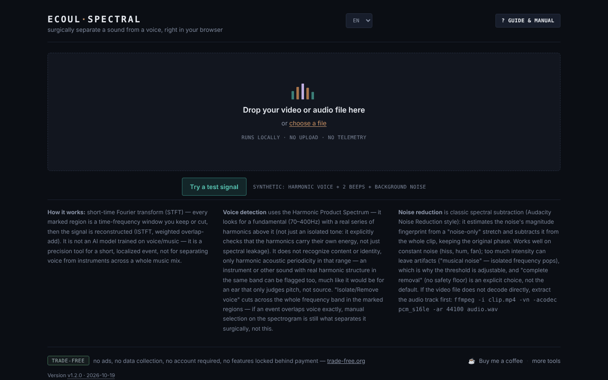

# Ecoul Spectral

**English** · [Română](README.ro.md) · [Français](README.fr.md) · [Italiano](README.it.md) · [Español](README.es.md) · [Português](README.pt.md) · [Deutsch](README.de.md) · [Magyar](README.hu.md)

**Version:** 1.2.1 · **Last updated:** 2026-10-22

Interface languages: **Română, English, Français, Italiano, Español, Português (PT), Deutsch, Magyar**

Separate a sound from a voice, surgically, right in the browser — a spectral editor in a single HTML file.

**Live app:** https://chiuta.github.io/EcoulSpectral/

## What it is

Ecoul Spectral is a spectrogram editor that runs locally in the browser. You load an audio or video file, mark a time–frequency region on the spectrogram, then isolate or remove it. It includes automatic voice detection, noise reduction and WAV export. According to the manual in the app, it is not a trained AI model: it uses the short-time Fourier transform (STFT), periodicity detection (Harmonic Product Spectrum) and classic spectral subtraction; it does not replace voice/instrumental separation on a complex music mix.

## Features

- Loading by drag-and-drop or "choose a file" (audio or video; if the video cannot be decoded, the app shows an ffmpeg command for extracting the audio).
- Spectrogram and waveform, minimap for the whole file, zoom with the wheel, selection by dragging, adjustable edges, precise fields `t0`, `t1`, `f0`, `f1`.
- "Isolate selection" / "Remove selection", "Trim to selection", "Fade in/out", "Normalize", "Invert".
- Undo/redo (↩ / ↪), loop on the selection, playback speed (0.5× – 2×), markers ("+ marker at current position").
- "Automatic events", with Mid (centre) / Side (lateral) components and "export all events".
- "Automatic voice": "Isolate voice" / "Remove voice" over the whole clip, with an adjustable threshold.
- "Background noise": profile from the selection, automatic (without voice) or from the quietest portion; "Reduce noise (whole clip)" with adjustable intensity. The button is active immediately after loading: if you have not set a profile, it automatically picks one (portions without voice, otherwise the quietest portion) and shows it in the status. The "Automatic voice" and "Background noise" sections open on first load.
- A/B comparison, "▶ result", "↻ use as new source", WAV download.
- Built-in guide: "Guided tour", "Manual", "Shortcuts".
- "Try a test signal": on the initial screen, it loads an 8 s synthetic signal generated in the browser (a harmonic voice with formants, two 2.4 kHz beeps and background noise), so you can try the selection, "Isolate voice" and noise reduction without a file of your own. On the first load in a session the "Automatic voice" section opens.
- Interface in 8 languages: RO, EN, FR, IT, ES, PT, DE, HU.

## User guide

1. Choose the language (RO / EN / FR / IT / ES / PT / DE / HU).
2. Drag the audio/video file onto the page or press "choose a file".
3. Drag with the mouse on the spectrogram to mark a region; adjust its edges or type the values into t0/t1/f0/f1 and press "Set selection".
4. Press "Isolate selection" (you keep only the region) or "Remove selection" (you delete it). Listen with "▶ result" and compare with "⇄ A/B".
5. For voice or noise, open the "Automatic voice" / "Background noise" sections and choose the noise profile before "Reduce noise".
6. If you want to keep editing on the result, press "↻ use as new source".
7. Download the result with "⤓ download WAV".
8. Shortcuts (when no slider or box is focused): **Space** plays/stops, **L** loop on the selection, **B** marker, **U** undo, **R** redo, **← →** move the selection (focused spectrogram), double-click jumps to the moment, **?** opens the guide, **Esc** closes it.

## Privacy and network

- Audio processing is done locally; the file is not uploaded to any server. I found no `fetch`/XHR calls or automatically loaded external resources in the code.
- **Local storage:** `localStorage`, key `ecoulSpectral.settings.v1` (thresholds, noise intensity, language, playback speed). Audio files are not saved.
- The links in the footer (Buy Me a Coffee, trade-free.org, chiuta.github.io) open only on click. The Open Graph tags in the code point to `chiuta.github.io`, with no effect at runtime.

## Technical requirements and limits

- A modern browser with Web Audio (`AudioContext`) and canvas; decoding of formats depends on the browser's codecs.
- The analysis uses an STFT with a window of 2048 samples and a hop of 512; files longer than 10 minutes require confirmation before loading, and processing them can take a long time and use a lot of memory.
- The export is 16-bit PCM WAV, at the source's sample rate (mono or stereo).

## Limitations

The slogan "surgical" describes the precision of manual selection on the spectrogram, not a perfect automatic separation: voice detection is based on harmonic periodicity and can confuse other harmonic sounds with voice, and on a complex music mix the result may contain artefacts. The sample `esantion-muzica-voce.wav` in the repository is a test file, not linked from the app. The provenance and rights to this sample are not documented in the repository (not linked from the app; to be confirmed by the author or removed). The slogan "surgical" (from the meta description, Open Graph and tagline) is kept as the author's expression; its meaning is the one above, and the editor does not guarantee a perfect separation of a voice from a complex mix.

## Running locally / offline

Download `index.html` and open it in a browser; it does not require internet. Decoding of formats depends on the browser's codecs.

## History / Changelog

### 1.2.1 — 2026-10-22

new **24-bit WAV** option for the result and event clips (checkbox next to the download button); the confirmation for very long files is an inline dialog instead of the blocking `confirm()`. mobile and accessibility polish: text at least 12 px and touch targets at least 24 px.

### 1.1.0 — 2026-10-14
- Backup and data labelling (fff-kit).

### 1.0.0 — 12 October 2026
- The version and the date of the last update are shown in the app (footer).

### 11.10.2026 (third update) — 11 October 2026
- Fixed: the noise-reduction buttons could not be pressed without extra steps (the section was closed, and "Reduce noise" stayed disabled until a profile was set). Now the section opens on first load, the button is active, and the missing profile is resolved automatically (the status message, translated into the 7 languages, says so).

### 11.10.2026 (second update) — 11 October 2026
- Initial screen: the "Try a test signal" button (synthetic signal generated locally; texts in all 7 languages). The "Automatic voice" section opens on first load.
- Documentation: new section "Technical requirements and limits".

### 11.10.2026 — 11 October 2026
- Accessibility: h1 heading (wordmark), main area (main) around the loading area/workspace; axe check without violations at 1280 and 360 px.
- Added a strict Content-Security-Policy (script with a hash; no network connections, only blob:/data:).

## License

MIT for the app's code and structure — see the `LICENSE` file. Any third-party libraries included in the file keep their own licenses. The sample file `esantion-muzica-voce.wav` is not part of this dedication; the rights to it remain reserved until a separate declaration.

## Author

Alexio — Alexandru-Ionuț Chiuță, contact: alexio@trom.tf.

## Audit

2026-10-10 (round 2, 2026-10-11: slogan and .wav sample only documented, no changes in the app) — checked the code (no network calls), accessibility (axe: contrast corrected) and operation (WAV loading, selection isolation, voice isolation).
