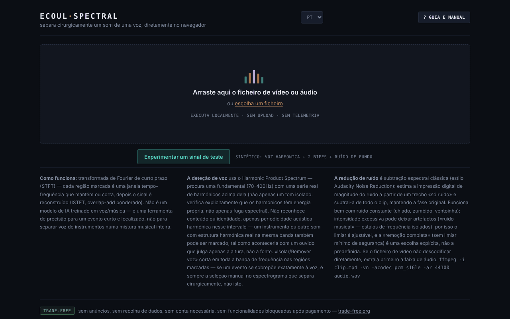

# Ecoul Spectral

[English](README.md) · [Română](README.ro.md) · [Français](README.fr.md) · [Italiano](README.it.md) · [Español](README.es.md) · **Português** · [Deutsch](README.de.md) · [Magyar](README.hu.md)

**Versão:** 2.0.0 · **Última atualização:** 2026-10-26

Idiomas da interface: **Română, English, Français, Italiano, Español, Português (PT), Deutsch, Magyar**

Separe um som de uma voz, com precisão cirúrgica, diretamente no navegador — um editor espectral num único ficheiro HTML.

**Aplicação online:** https://chiuta.github.io/EcoulSpectral/

## O que é

O Ecoul Spectral é um editor de espectrogramas que corre localmente no navegador. Carrega um ficheiro de áudio ou vídeo, marca no espectrograma uma região tempo–frequência e depois isola-a ou remove-a. Inclui deteção automática de voz, redução de ruído e exportação WAV. Segundo o manual da aplicação, não é um modelo de IA treinado: usa a transformada de Fourier de curta duração (STFT), a deteção de periodicidade (Harmonic Product Spectrum) e a subtração espectral clássica; não substitui a separação voz/instrumental numa mistura musical complexa.

## Funcionalidades

- Carregamento por arrastar e largar ou «escolher um ficheiro» (áudio ou vídeo; se o vídeo não for descodificado, a aplicação mostra um comando ffmpeg para extrair o áudio).
- Espectrograma e forma de onda, minimapa de todo o ficheiro, zoom com a roda, seleção por arrastamento, margens ajustáveis, campos precisos `t0`, `t1`, `f0`, `f1`.
- «Isolar seleção» / «Remover seleção», «Cortar para a seleção», «Fade in/out», «Normalizar», «Inverter».
- Anular/refazer (↩ / ↪), ciclo sobre a seleção, velocidade de reprodução (0,5× – 2×), marcadores («+ marcador na posição atual»).
- «Eventos automáticos», com componentes Mid (centro) / Side (lateral) e «exportar todos os eventos».
- «Voz automática»: «Isolar a voz» / «Remover a voz» em todo o clipe, com limiar ajustável.
- «Ruído de fundo»: perfil a partir da seleção, automático (sem voz) ou da porção mais silenciosa; «Reduzir o ruído (todo o clipe)» com intensidade ajustável. O botão fica ativo logo após o carregamento: se não definiu um perfil, escolhe automaticamente um (porções sem voz, caso contrário a porção mais silenciosa) e mostra-o no estado. As secções «Voz automática» e «Ruído de fundo» abrem-se no primeiro carregamento.
- Comparação A/B, «▶ resultado», «↻ usar como nova fonte», descarga WAV.
- Guia integrado: «Visita guiada», «Manual», «Atalhos».
- «Experimentar um sinal de teste»: no ecrã inicial, carrega um sinal sintético de 8 s gerado no navegador (voz harmónica com formantes, dois bipes de 2,4 kHz e ruído de fundo), para experimentar a seleção, «Isolar a voz» e a redução de ruído sem um ficheiro próprio. No primeiro carregamento da sessão abre-se a secção «Voz automática».
- Interface em 8 idiomas: RO, EN, FR, IT, ES, PT, DE, HU.

## Manual de utilização

1. Escolha o idioma (RO / EN / FR / IT / ES / PT / DE / HU).
2. Arraste o ficheiro de áudio/vídeo para a página ou prima «escolher um ficheiro».
3. Arraste com o rato sobre o espectrograma para marcar uma região; ajuste as margens ou escreva os valores em t0/t1/f0/f1 e prima «Definir seleção».
4. Prima «Isolar seleção» (mantém apenas a região) ou «Remover seleção» (apaga-a). Ouça com «▶ resultado» e compare com «⇄ A/B».
5. Para a voz ou o ruído, abra as secções «Voz automática» / «Ruído de fundo» e escolha o perfil de ruído antes de «Reduzir o ruído».
6. Se quiser continuar a editar sobre o resultado, prima «↻ usar como nova fonte».
7. Descarregue o resultado com «⤓ descarregar WAV».
8. Atalhos (quando nenhum controlo deslizante ou caixa tem o foco): **Espaço** reproduz/pára, **L** ciclo sobre a seleção, **B** marcador, **U** anula, **R** refaz, **← →** deslocam a seleção (espectrograma com o foco), o duplo clique salta para o instante, **?** abre o guia, **Esc** fecha-o.

## Privacidade e rede

- O processamento de áudio é feito localmente; o ficheiro não é enviado para nenhum servidor. Não encontrei no código chamadas `fetch`/XHR nem recursos externos carregados automaticamente.
- **Armazenamento local:** `localStorage`, chave `ecoulSpectral.settings.v1` (limiares, intensidade do ruído, idioma, velocidade de reprodução). Os ficheiros de áudio não são guardados.
- As ligações do rodapé (Buy Me a Coffee, trade-free.org, chiuta.github.io) só se abrem ao clicar. As etiquetas Open Graph do código apontam para `chiuta.github.io`, sem efeito na execução.

## Requisitos técnicos e limites

- Navegador moderno com Web Audio (`AudioContext`) e canvas; a descodificação dos formatos depende dos codecs do navegador.
- A análise usa uma STFT com janela de 2048 amostras e passo de 512; os ficheiros com mais de 10 minutos exigem confirmação antes do carregamento, e o seu processamento pode demorar e consumir muita memória.
- A exportação é WAV PCM de 16 bits, com a frequência de amostragem da fonte (mono ou estéreo).

## Limitações

O slogan «cirúrgico» descreve a precisão da seleção manual sobre o espectrograma, não uma separação automática perfeita: a deteção de voz baseia-se na periodicidade harmónica e pode confundir outros sons harmónicos com a voz, e numa mistura musical complexa o resultado pode conter artefactos. A amostra `esantion-muzica-voce.wav` do repositório é um ficheiro de teste, não ligado a partir da aplicação. A proveniência e os direitos sobre esta amostra não estão documentados no repositório (não ligado a partir da aplicação; a confirmar pelo autor ou a eliminar). O slogan «cirúrgico» (da meta description, do Open Graph e do tagline) é mantido como expressão do autor; o seu significado é o indicado acima, e o editor não garante uma separação perfeita de uma voz a partir de uma mistura complexa.

## Execução local / offline

Descarregue `index.html` e abra-o no navegador; não requer internet. A descodificação dos formatos depende dos codecs do navegador.

## Histórico / Changelog

### 1.2.3 — 2026-10-22

fff-kit 1.1.4: áreas de toque e texto mínimo.

### 1.2.2 — 2026-10-22

fff-kit 1.1.2: PBKDF2 com 600.000 iterações, proteção anti-clickjacking.

### 1.2.1 — 2026-10-22

nova opção **WAV de 24 bits** para o resultado e os clipes de eventos (caixa junto ao botão de transferência); a confirmação para ficheiros muito longos é uma caixa de diálogo integrada em vez do `confirm()` bloqueante. melhorias para telemóvel e acessibilidade: texto de pelo menos 12 px e áreas táteis de pelo menos 24 px.

### 1.1.0 — 2026-10-14
- Cópia de segurança e etiquetagem de dados (fff-kit).

### 1.0.0 — 12 de outubro de 2026
- A versão e a data da última atualização são apresentadas na aplicação (rodapé).

### 11.10.2026 (terceira atualização) — 11 de outubro de 2026
- Corrigido: os botões de redução de ruído não podiam ser premidos sem passos adicionais (a secção estava fechada e «Reduzir o ruído» permanecia desativado até ser definido um perfil). Agora a secção abre-se no primeiro carregamento, o botão está ativo e a falta de perfil resolve-se automaticamente (a mensagem de estado, traduzida nos 7 idiomas, indica-o).

### 11.10.2026 (segunda atualização) — 11 de outubro de 2026
- Ecrã inicial: o botão «Experimentar um sinal de teste» (sinal sintético gerado localmente; textos nos 7 idiomas). A secção «Voz automática» abre-se no primeiro carregamento.
- Documentação: nova secção «Requisitos técnicos e limites».

### 11.10.2026 — 11 de outubro de 2026
- Acessibilidade: título h1 (wordmark), zona principal (main) em torno da área de carregamento/espaço de trabalho; verificação axe sem violações a 1280 e 360 px.
- Adicionada uma Content-Security-Policy estrita (script com hash; sem ligações de rede, apenas blob:/data:).

## Licença

MIT para o código e a estrutura da aplicação — ver o ficheiro `LICENSE`. As eventuais bibliotecas de terceiros incluídas no ficheiro mantêm as suas próprias licenças. O ficheiro de teste `esantion-muzica-voce.wav` não faz parte desta dedicatória; os direitos sobre ele permanecem reservados até uma declaração separada.

## Autor

Alexio — Alexandru-Ionuț Chiuță, contacto: alexio@trom.tf.

## Resumo
O Ecoul Spectral é um editor de espectrogramas num único ficheiro, no navegador: selecione uma região tempo-frequência e isole-a ou remova-a, detete ou remova a voz (harmonic product spectrum), reduza o ruído (subtração espectral) e exporte em WAV. Usa processamento de sinal clássico, não um modelo de IA treinado. O áudio nunca sai do navegador; apenas as definições são guardadas em localStorage. Interface em 8 idiomas. Licença: MIT.

Auditoria: 2026-10-10 (ronda 2, 2026-10-11: slogan e amostra .wav apenas documentados, sem alterações na aplicação) — verificado o código (sem chamadas de rede), a acessibilidade (axe: contraste corrigido) e o funcionamento (carregamento WAV, isolamento da seleção, isolamento da voz).
