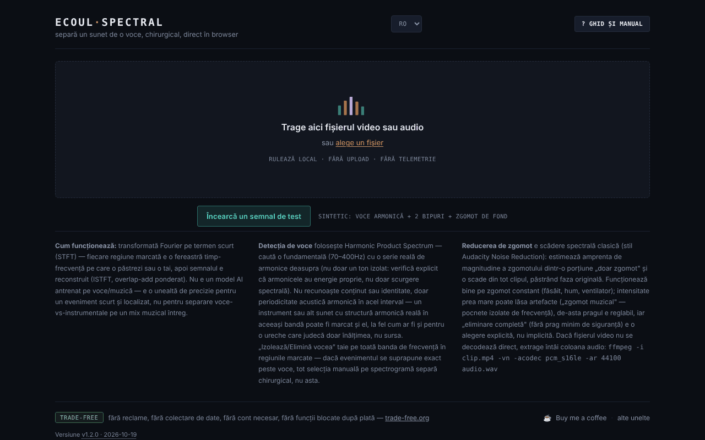

# Ecoul Spectral

[English](README.md) · **Română** · [Français](README.fr.md) · [Italiano](README.it.md) · [Español](README.es.md) · [Português](README.pt.md) · [Deutsch](README.de.md) · [Magyar](README.hu.md)

**Versiune:** 2.1.0 · **Ultima actualizare:** 2026-10-27

**Stare:** stabil · **Offline:** complet

Limbile interfeței: **Română, English, Français, Italiano, Español, Português (PT), Deutsch, Magyar**

Separă un sunet de o voce, chirurgical, direct în browser — editor spectral pe un singur fișier HTML.

**Live:** https://chiuta.github.io/EcoulSpectral/

## Ce este

Ecoul Spectral este un editor de spectrogramă care rulează local în browser. Încarci un fișier audio sau video, marchezi pe spectrogramă o regiune timp–frecvență, apoi o izolezi sau o elimini. Include detecție automată de voce, reducere de zgomot și export WAV. Conform manualului din aplicație, nu este un model AI antrenat: folosește transformata Fourier pe termen scurt (STFT), detecție de periodicitate (Harmonic Product Spectrum) și scădere spectrală clasică; nu înlocuiește separarea voce/instrumental pe un mix muzical complex.

## Funcții

- Încărcare prin drag-and-drop sau „alege un fișier” (audio sau video; dacă video-ul nu se decodează, aplicația afișează o comandă ffmpeg pentru extragerea audio).
- Spectrogramă și formă de undă, minimap pentru tot fișierul, zoom cu rotița, selecție prin tragere, margini ajustabile, câmpuri precise `t0`, `t1`, `f0`, `f1`.
- „Izolează selecția” / „Elimină selecția”, „Decupează la selecție”, „Fondu intrare/ieșire”, „Normalizează”, „Inversează”.
- Anulare/refacere (↩ / ↪), loop pe selecție, viteză de redare (0.5× – 2×), marcaje („+ marcaj la poziția curentă”).
- „Evenimente automate”, cu componente Mid (centru) / Side (lateral) și „exportă toate evenimentele”.
- „Voce automată”: „Izolează vocea” / „Elimină vocea” pe tot clipul, cu prag reglabil.
- „Zgomot de fond”: profil din selecție, automat (fără voce) sau din cea mai liniștită porțiune; „Reduce zgomotul (tot clipul)” cu intensitate reglabilă. Butonul este activ imediat după încărcare: dacă nu ai setat un profil, alege automat unul (porțiuni fără voce, altfel cea mai liniștită porțiune) și îl afișează în stare. Secțiunile „Voce automată” și „Zgomot de fond” se deschid la prima încărcare.
- Comparare A/B, „▶ rezultat”, „↻ folosește ca sursă nouă”, descărcare WAV.
- Ghid integrat: „Tur ghidat”, „Manual”, „Scurtături”.
- „Încearcă un semnal de test”: pe ecranul inițial, încarcă un semnal sintetic de 8 s generat în browser (voce armonică cu formanți, două bipuri de 2,4 kHz și zgomot de fond), ca să încerci selecția, „Izolează vocea” și reducerea zgomotului fără un fișier propriu. La prima încărcare din sesiune se deschide secțiunea „Voce automată”.
- Interfață în 8 limbi: RO, EN, FR, IT, ES, PT, DE, HU.

## Novități v2.0.0

- **Pensulă spectrală**: marchezi o zonă timp-frecvență pe spectrogramă și o adaugi ca zonă atenuată (−3, −6, −12, −24 sau −40 dB, cu muchie moale reglabilă). Zonele sunt doar o listă de parametri (maximum 80, suprapunerile se compun), așa că **anularea și refacerea sunt nelimitate**, iar ștergerea se poate face pe element. „Aplică pensula” procesează tot clipul și produce un rezultat (A/B, descărcare WAV, folosire ca sursă). Totul rulează local.
- Pictura spectrală, segmentele cu export și compararea a două înregistrări sunt implementate din 2.1.0 (vezi mai jos).

## Manual de utilizare

1. Alege limba (RO / EN / FR / IT / ES / PT / DE / HU).
2. Trage fișierul audio/video pe pagină sau apasă „alege un fișier”.
3. Trage cu mouse-ul pe spectrogramă pentru a marca o regiune; ajustează-i marginile sau scrie valorile în t0/t1/f0/f1 și apasă „Setează selecția”.
4. Apasă „Izolează selecția” (păstrezi doar regiunea) sau „Elimină selecția” (o ștergi). Ascultă cu „▶ rezultat” și compară cu „⇄ A/B”.
5. Pentru voce sau zgomot, deschide secțiunile „Voce automată” / „Zgomot de fond” și alege profilul de zgomot înainte de „Reduce zgomotul”.
6. Dacă vrei să continui editarea pe rezultat, apasă „↻ folosește ca sursă nouă”.
7. Descarcă rezultatul cu „⤓ descarcă WAV”.
8. Scurtături (când nu e focalizat un slider sau o casetă): **Spațiu** redă/oprește, **L** buclă pe selecție, **B** marcaj, **U** anulează, **R** refă, **← →** deplasează selecția (spectrograma focalizată), dublu-click sare la moment, **?** deschide ghidul, **Esc** îl închide.

## Confidențialitate și rețea

- Procesarea audio se face local; fișierul nu este încărcat pe niciun server. Nu am găsit în cod apeluri `fetch`/XHR sau resurse externe încărcate automat.
- **Stocare locală:** `localStorage`, cheia `ecoulSpectral.settings.v1` (praguri, intensitate zgomot, limbă, viteză de redare). Fișierele audio nu sunt salvate.
- Linkurile din subsol (Buy Me a Coffee, trade-free.org, chiuta.github.io) se deschid doar la click. Etichetele Open Graph din cod indică `chiuta.github.io`, fără efect la rulare.

## Cerințe tehnice și limite

- Browser modern cu Web Audio (`AudioContext`) și canvas; decodarea formatelor depinde de codecurile browserului.
- Analiza folosește STFT cu fereastră de 2048 de eșantioane și pas de 512; fișierele mai lungi de 10 minute cer confirmare înainte de încărcare, iar prelucrarea lor poate dura și consuma multă memorie.
- Exportul este WAV PCM pe 16 biți, cu frecvența de eșantionare a sursei (mono sau stereo).

## Limitări

Sloganul „chirurgical” descrie precizia selecției manuale pe spectrogramă, nu o separare automată perfectă: detecția de voce se bazează pe periodicitate armonică și poate confunda alte sunete armonice cu vocea, iar pe un mix muzical complex rezultatul poate conține artefacte. Eșantionul `esantion-muzica-voce.wav` din repository este un fișier de probă, nelegat din aplicație. Proveniența și drepturile asupra acestui eșantion nu sunt documentate în repository (nelegat din aplicație; de confirmat de autor sau de eliminat). Sloganul „chirurgical” (din meta description, Open Graph și tagline) este păstrat ca expresie a autorului; semnificația lui este cea de mai sus, iar editorul nu garantează o separare perfectă a unei voci dintr-un mix complex.

## Rulare locală / offline

Descarcă `index.html` și deschide-l în browser; nu necesită internet. Decodarea formatelor depinde de codecurile browserului.

## Formate și operații (din codul real)

- **Intrare:** orice fișier audio sau video pe care browserul îl poate decoda (`decodeAudioData`; de obicei WAV, MP3, AAC/M4A, OGG/Opus, FLAC și pista audio din MP4/WebM, în funcție de codecurile browserului). Dacă decodarea eșuează, aplicația arată o comandă ffmpeg. Peste 10 minute cere confirmare. Toate canalele (mono/stereo) sunt păstrate.
- **Analiză:** STFT, fereastră Hann de 2048 de eșantioane, pas de 512.
- **Filtrare/mascare:** „Izolează selecția” / „Elimină selecția” (dreptunghi timp–frecvență cu margini reglabile, resinteză prin ISTFT cu suprapunere-adunare).
- **Pensulă spectrală:** până la 80 de zone atenuate (până la −40 dB, margine moale, anulare/refacere nelimitate). Pensula **atenuează**. Din 2.1.0 există și **pictura spectrală**: adaugă sunet sintetic (ton = o sinusoidă pe bin, sau zgomot cu bandă limitată) în dreptunghiul selectat, la un nivel RMS ales, plafonat la −12 dBFS, prin aceeași trecere STFT/ISTFT. Adaugă sunet nou; nu recuperează informație pierdută. Noi: **segmente** (intervale de timp etichetate: ascultare, WAV, export CSV/JSON) și **compararea a două înregistrări** (spectru mediu pe termen lung în benzi de 1/3 de octavă, dBFS necalibrat, tabel/grafic/CSV, ascultare A/B). Textele noi au fost scrise în RO și EN; traducerile FR/IT/ES/PT/DE/HU sunt automate, nevalidate de vorbitori nativi.
- **Voce automată:** detecție armonică (Harmonic Product Spectrum, 70–400 Hz) cu izolare/eliminare pe tot clipul.
- **Zgomot de fond:** scădere spectrală, profil din selecție / automat (fără voce) / cea mai liniștită porțiune; opțional „eliminare completă”.
- **Evenimente automate** cu componente Mid/Side și export al tuturor evenimentelor; **editare de bază:** fade in/out, tăiere la selecție, normalizare, inversare, viteză 0,5×–2×, repere, buclă, comparare A/B.
- **Ieșire:** WAV PCM pe 16 sau 24 de biți, la rata sursei. Nu exportă MP3/FLAC.

## Capturi de ecran

Depozitul conține captura ecranului de start. Capturile spațiului de lucru (selecție, voce, zgomot): de adăugat de autor.

## Istoric / Changelog
- **2.1.0 — 2026-10-27:** spectral paint, segments with CSV/JSON/WAV export, two-recording comparison (details: CHANGELOG.md).
- **2.0.1 — 2026-10-27:** descrierea (meta, Open Graph, manifest, `app.json`) și README (8 limbi) spun acum concret ce formate și operații are aplicația, pe baza codului; notă „Capturi de ecran: de adăugat de autor”; linii Stare/Offline; CHANGELOG.md (anterior: v2.0.0).

### 1.2.3 — 2026-10-22

fff-kit 1.1.4: ținte tactile și text minim.

### 1.2.2 — 2026-10-22

fff-kit 1.1.2: PBKDF2 600 000 iterații, protecție anti-clickjacking.

### 1.2.1 — 2026-10-22

opțiune nouă **WAV pe 24 de biți** pentru rezultat și clipurile de evenimente (casetă lângă butonul de descărcare); confirmarea pentru fișierele foarte lungi este un dialog inline, nu `confirm()` blocant. finisaje pentru mobil și accesibilitate: text de cel puțin 12 px și ținte tactile de cel puțin 24 px.

### 1.1.0 — 2026-10-14
- Copie de rezervă și etichetare date (fff-kit).

### 1.0.0 — 12 octombrie 2026
- Versiunea și data ultimei actualizări sunt afișate în aplicație (subsol).

### 11.10.2026 (a treia actualizare) — 11 octombrie 2026
- Corectat: butoanele de reducere a zgomotului nu puteau fi apăsate fără pași suplimentari (secțiunea era închisă, iar „Reduce zgomotul” rămânea dezactivat până la setarea unui profil). Acum secțiunea se deschide la prima încărcare, butonul e activ, iar lipsa profilului se rezolvă automat (mesajul de stare, tradus în cele 7 limbi, o spune).

### 11.10.2026 (a doua actualizare) — 11 octombrie 2026
- Ecran inițial: butonul „Încearcă un semnal de test” (semnal sintetic generat local; textele în toate cele 7 limbi). Secțiunea „Voce automată” se deschide la prima încărcare.
- Documentare: secțiune nouă „Cerințe tehnice și limite”.

### 11.10.2026 — 11 octombrie 2026
- Accesibilitate: titlu h1 (wordmark), zonă principală (main) în jurul zonei de încărcare/spațiului de lucru; verificare axe fără încălcări la 1280 și 360 px.
- Adăugat Content-Security-Policy strict (script cu hash; fără conexiuni de rețea, doar blob:/data:).

## Licență

MIT pentru codul și structura aplicației — vezi fișierul `LICENSE`. Eventualele biblioteci terțe incluse în fișier își păstrează licențele proprii. Fișierul de probă `esantion-muzica-voce.wav` nu face parte din această dedicare; drepturile asupra lui rămân rezervate până la o declarație separată.

## Autor

Alexio — Alexandru-Ionuț Chiuță, contact: alexio@trom.tf.

## Rezumat

Ecoul Spectral este un editor de spectrograme în browser, într-un singur fișier: selectezi o regiune timp-frecvență și o izolezi sau o elimini, detectezi sau elimini vocea (spectru de produs armonic), reduci zgomotul (scădere spectrală), apoi exporți WAV. Folosește DSP clasic, nu un model AI antrenat. Sunetul nu părăsește niciodată browserul; în localStorage se păstrează doar setările. 8 limbi de interfață. Licență: MIT.

Audit: 2026-10-10 (rundă 2, 2026-10-11: slogan și eșantion .wav doar documentate, fără modificări în aplicație) — verificat codul (fără apeluri de rețea), accesibilitatea (axe: contrast corectat) și funcționarea (încărcare WAV, izolare selecție, izolare voce).
